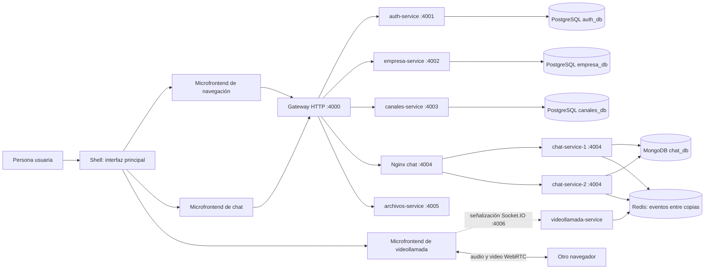

# Arquitectura del sistema de gestión empresarial

## Para qué sirve este documento

Describe la arquitectura que se observa en el repositorio al 18 de noviembre de 2026 y separa lo implementado de lo planeado. Actualiza este documento cuando cambien las decisiones o el despliegue.

## Resumen sencillo

La aplicación se parece a un espacio de trabajo empresarial: tiene inicio de sesión, empresas, canales, subcanales, hilos y mensajes. La interfaz está dividida en aplicaciones pequeñas llamadas **microfrontends**. El backend está dividido en **microservicios**, cada uno responsable de una parte. El **gateway** es la puerta única por la que la interfaz consulta esos servicios.

Cuando alguien envía un mensaje, el microfrontend de chat hace una petición HTTP al gateway; este la dirige al balanceador Nginx y luego a una de las dos copias del servicio de chat, que guarda el mensaje en MongoDB. Las videollamadas tienen su propio microfrontend y microservicio: Socket.IO coordina su inicio, y WebRTC conecta el audio y video directamente entre navegadores.

## Mapa de componentes

El diagrama representa la composición descrita por `docker-compose.yml` y el gateway. El puerto 4004 del computador apunta a Nginx, que reenvía tanto HTTP como WebSocket a una copia del chat.

## Responsabilidades

| Parte | Responsabilidad observada |
|---|---|
| `frontends/shell` | Aplicación principal, rutas, sesión y composición de pantallas. |
| `frontends/mf-navegacion` | Componentes para explorar y administrar canales, subcanales e hilos. |
| `frontends/mf-chat` | Interfaz de conversación, mensajes, respuestas, reacciones y adjuntos. |
| `frontends/mf-videollamada` | Interfaz independiente de videollamada, integrada en el shell cuando hay un hilo seleccionado. |
| `gateway` | Entrada HTTP en el puerto 4000; enruta `/auth`, `/empresas`, `/canales`, `/subcanales`, `/hilos`, `/mensajes` y `/archivos`. |
| `auth-service` | Operaciones del backend de autenticación. La interfaz también usa Firebase Auth para la sesión. |
| `empresa-service` | Datos y operaciones de empresas. |
| `canales-service` | Canales, subcanales e hilos. |
| `chat-load-balancer` (Nginx) | Distribuye las peticiones HTTP y WebSocket entre las dos copias del servicio de chat. |
| `chat-service` | Consulta, almacenamiento, eliminación y reacciones de mensajes; publica eventos por Socket.IO. |
| `redis` | Comparte eventos de Socket.IO entre las dos copias del servicio de chat. |
| `videollamada-service` | Administra salas de llamada y reenvía la señalización WebRTC por Socket.IO; Redis permite distribuirla entre instancias. |
| `archivos-service` | Recibe adjuntos por el gateway y los guarda en `uploads` local si Cloudinary no está configurado; Cloudinary también se puede configurar en el backend. |

## Persistencia y puertos locales

La configuración actual crea **cuatro bases/instancias de datos**: tres bases PostgreSQL (`auth_db`, `empresa_db`, `canales_db`) y una base MongoDB (`chat_db`). Por lo tanto, “dos bases de datos” no describe la configuración que hoy aparece en `docker-compose.yml`; conviene confirmar con el equipo si se referían a dos tecnologías o a otra versión del proyecto.

| Componente | Puerto expuesto localmente | Persistencia |
|---|---:|---|
| Shell | 5173 | — |
| Microfrontend de navegación | 5174 | — |
| Microfrontend de chat | 5175 | — |
| Microfrontend de videollamada | 5176 | — |
| Gateway | 4000 | — |
| Auth | interno 4001 | PostgreSQL `auth_db` |
| Empresas | interno 4002 | PostgreSQL `empresa_db` |
| Canales | interno 4003 | PostgreSQL `canales_db` |
| Nginx para chat | 4004 | Distribuye al servicio de chat |
| `chat-service-1` y `chat-service-2` | interno 4004 cada uno | MongoDB `chat_db`; Redis para eventos |
| `videollamada-service` | 4006 | Redis para señalización entre instancias |
| Archivos | interno 4005 | Volumen local configurado; proveedor externo opcional |

Los servicios y las bases se definen en `docker-compose.yml`. Para arrancar el proyecto hay que seguir las instrucciones que acuerde el equipo para las variables del archivo `.env`; no se deben publicar claves reales.

## Recorrido de un mensaje hoy

1. La persona abre un hilo en la aplicación.
2. `mf-chat` solicita el historial por HTTP al gateway. El gateway lo reenvía a Nginx, que selecciona una copia del servicio de chat.
3. `chat-service` consulta o guarda el mensaje en MongoDB.
4. Al guardar, el servicio emite `nuevo-mensaje` a la sala Socket.IO de ese hilo. Para reacciones emite `mensaje-actualizado`.
5. Los navegadores conectados a esa sala reciben el evento sin volver a consultar cada pocos segundos. Al reconectarse, el navegador vuelve a cargar el historial para recuperar lo que pudo perder.

Eventos de sala que implementa el servidor: `unirse-hilo` y `salir-hilo`, con el identificador UUID del hilo. El cliente escucha `nuevo-mensaje` y `mensaje-actualizado`. El envío y las reacciones siguen usando HTTP; Socket.IO avisa a los demás participantes. En Docker Compose, el cliente se conecta a `http://localhost:4004` (configurable mediante `VITE_SOCKET_URL`), que es el puerto publicado por Nginx. El cliente está configurado para WebSocket, así evita necesitar sesiones persistentes para long-polling.

## Videollamadas implementadas como microfrontend y microservicio

La videollamada está asociada al **hilo seleccionado** dentro de un canal y permite hasta ocho participantes. Al presionar **Videollamada**, las personas conectadas al hilo reciben la invitación y pueden aceptarla o rechazarla. La pantalla muestra una cuadrícula con el video local y los videos remotos, con controles para silenciar, apagar la cámara y colgar.

**WebRTC** transporta audio y video directamente entre los navegadores. El backend no graba ni retransmite esos medios. El microfrontend independiente `mf-videollamada` se compone desde `shell` junto al chat cuando se selecciona un hilo. Se conecta directamente al microservicio `videollamada-service` en el puerto 4006; los participantes intercambian ofertas, respuestas y candidatos ICE por pares a través de la sala `llamada:<hiloId>`. Esta primera versión usa una conexión WebRTC directa entre cada par de personas (malla), con un máximo de ocho personas por llamada. Redis permite que la señalización funcione entre instancias del microservicio.

La llamada en malla consume más ancho de banda a medida que se suman personas, porque cada navegador envía su audio y video a cada uno de los demás. Para grupos mayores se recomienda pasar a un servidor de medios SFU.

### Eventos de videollamada

| Evento | Dirección | Función |
|---|---|---|
| `llamada:unirse` | Cliente → servidor | Solicita entrar a la sala del hilo; devuelve un acuse con los participantes presentes o un error. |
| `llamada:invitar` | Cliente → servidor | Avisa a las demás personas conectadas al hilo de una llamada entrante. |
| `llamada:entrante` | Servidor → otros clientes del hilo | Muestra los botones Aceptar y Rechazar. |
| `llamada:rechazar` / `llamada:rechazada` | Cliente ↔ servidor | Rechaza la invitación y permite que quien llamó cierre su conexión local. |
| `llamada:senal` | Cliente ↔ servidor ↔ cliente | Intercambia `oferta`, `respuesta` y `candidato` para negociar WebRTC. El servidor solo reenvía la señal a la otra persona de la sala. |
| `llamada:estado-medios` | Cliente ↔ servidor → sala | Avisa si una persona apagó o encendió su cámara o micrófono; el microfrontend muestra los íconos correspondientes. |
| `llamada:participante` | Servidor → sala de llamada | Avisa a quien inició la llamada que otra persona aceptó y permite crear la oferta WebRTC. |
| `llamada:salir`, `llamada:participante-salio`, `llamada:cancelada` | Cliente ↔ servidor | Cierra la llamada, detiene cámara/micrófono y avisa si alguien cuelga o se desconecta. |

### Red y límites de la demo

El cliente usa `VITE_VIDEOLLAMADA_URL` (por defecto `http://localhost:4006`) y un servidor STUN público para descubrir rutas de red. Algunas redes corporativas, VPN o firewalls requieren configurar un servidor TURN; si la llamada no conecta entre redes distintas, TURN es el siguiente componente que debe agregarse. Para probar se necesitan dos usuarios/navegadores en el mismo hilo y conceder permiso de cámara y micrófono. Los navegadores requieren HTTPS en despliegues; `localhost` está permitido para desarrollo.

## Estado del trabajo

| Función | Estado en el repositorio revisado |
|---|---|
| Microservicios y gateway HTTP | Configurados en Compose. |
| Microfrontends | Hay shell y proyectos separados; confirmar integración de navegación, cuyo `App.tsx` aún es la plantilla de Vite. |
| Mensajes persistidos | Endpoints REST y almacenamiento MongoDB implementados. |
| Actualización de mensajes en vivo | Socket.IO implementado; sincroniza el historial por HTTP al entrar y reconectar. |
| Videollamadas en canales/hilos | Microfrontend y microservicio propios; videollamada WebRTC en malla de hasta ocho personas en el hilo seleccionado. TURN y SFU quedan fuera del alcance actual. |
| Módulo local con Google Drive | Pendiente según el reparto del equipo; revisar `local-module` para delimitar su estado. |
| Balanceo de cargas del chat | Nginx con dos réplicas de `chat-service` y estrategia `least_conn`; Redis comparte los eventos entre réplicas. |
| Despliegue del backend y hosting de un microfrontend | Pendiente según el reparto. |
| Documentación de arquitectura | Describe componentes, recorrido de mensajes, videollamadas, eventos y límites actuales. |

## Cómo probar la videollamada

1. Levanta el proyecto con Docker Compose y espera que `chat-service-1`, `chat-service-2`, Redis, Nginx y los microfrontends estén activos.
2. Abre la aplicación desde dos o más navegadores o sesiones distintas. Todos los usuarios deben entrar en la misma empresa, canal, subcanal e hilo (máximo ocho personas).
3. En el hilo, una persona presiona **Videollamada** y permite el uso de cámara y micrófono.
4. La otra persona acepta la invitación y también concede los permisos.
5. Comprueba el video remoto, los controles de cámara/micrófono y que colgar detiene los dispositivos.

Para trabajar en equipo, cada integrante crea una rama, realiza commits pequeños y abre una solicitud de integración (pull request). Coordina cambios en `services/chat-service/src/socket.ts` con quien mantenga Socket.IO para evitar sobrescribir eventos.

## Archivos de referencia

- `docker-compose.yml`: servicios, puertos, bases y volúmenes.
- `gateway/src/index.ts`: rutas HTTP y destinos de cada servicio.
- `services/chat-service/src/index.ts`: arranque del servicio de chat.
- `services/chat-service/src/routes/mensajes.routes.ts`: rutas HTTP de mensajes.
- `services/chat-service/src/controllers/mensajes.controller.ts`: lógica de lectura y escritura.
- `frontends/mf-chat/src/features/chat/chat.api.ts`: llamadas HTTP e integración cliente de Socket.IO.
- `services/chat-service/src/socket.ts`: salas y eventos de Socket.IO; adaptador Redis opcional.
- `services/chat-load-balancer/nginx.conf`: distribución de tráfico HTTP/WebSocket.
- `frontends/mf-chat/src/features/chat/components/ChatArea.tsx`: pantalla de conversación y ubicación del control de llamada.
- `frontends/mf-videollamada/src/components/VideoLlamada.tsx`: captura de cámara/micrófono, conexión WebRTC y controles de llamada.
- `services/videollamada-service/src/socket.ts`: salas y señalización Socket.IO del microservicio de videollamada.
- `frontends/shell/src/App.tsx`: rutas de la aplicación principal.
