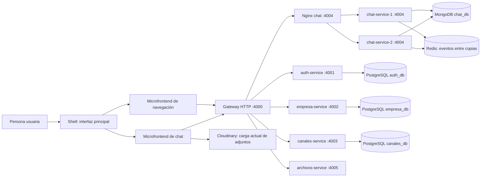

# Arquitectura del sistema de gestión empresarial

## Para qué sirve este documento

Describe la arquitectura que se observa en el repositorio al 18 de noviembre de 2026 y separa lo implementado de lo planeado. Actualiza este documento cuando cambien las decisiones o el despliegue.

## Resumen sencillo

La aplicación se parece a un espacio de trabajo empresarial: tiene inicio de sesión, empresas, canales, subcanales, hilos y mensajes. La interfaz está dividida en aplicaciones pequeñas llamadas **microfrontends**. El backend está dividido en **microservicios**, cada uno responsable de una parte. El **gateway** es la puerta única por la que la interfaz consulta esos servicios.

Cuando alguien envía un mensaje, el microfrontend de chat hace una petición HTTP al gateway; este la dirige al balanceador Nginx y luego a una de las dos copias del servicio de chat, que guarda el mensaje en MongoDB. Socket.IO avisa a quienes están conectados al mismo hilo. Redis comparte esos avisos entre las dos copias del servicio.

## Mapa de componentes

El diagrama representa la composición descrita por `docker-compose.yml` y el gateway. El puerto 4004 del computador apunta a Nginx, que reenvía tanto HTTP como WebSocket a una copia del chat.

## Responsabilidades

| Parte | Responsabilidad observada |
|---|---|
| `frontends/shell` | Aplicación principal, rutas, sesión y composición de pantallas. |
| `frontends/mf-navegacion` | Componentes para explorar y administrar canales, subcanales e hilos. |
| `frontends/mf-chat` | Interfaz de conversación, mensajes, respuestas, reacciones y selección de adjuntos. |
| `gateway` | Entrada HTTP en el puerto 4000; enruta `/auth`, `/empresas`, `/canales`, `/subcanales`, `/hilos`, `/mensajes` y `/archivos`. |
| `auth-service` | Operaciones del backend de autenticación. La interfaz también usa Firebase Auth para la sesión. |
| `empresa-service` | Datos y operaciones de empresas. |
| `canales-service` | Canales, subcanales e hilos. |
| `chat-load-balancer` (Nginx) | Distribuye las peticiones HTTP y WebSocket entre las dos copias del servicio de chat. |
| `chat-service` | Consulta, almacenamiento, eliminación y reacciones de mensajes; publica eventos por Socket.IO. |
| `redis` | Comparte eventos de Socket.IO entre las dos copias del servicio de chat. |
| `archivos-service` | Recibe adjuntos por el gateway y los guarda en `uploads` local si Cloudinary no está configurado; Cloudinary también se puede configurar en el backend. |

## Persistencia y puertos locales

La configuración actual crea **cuatro bases/instancias de datos**: tres bases PostgreSQL (`auth_db`, `empresa_db`, `canales_db`) y una base MongoDB (`chat_db`). Por lo tanto, “dos bases de datos” no describe la configuración que hoy aparece en `docker-compose.yml`; conviene confirmar con el equipo si se referían a dos tecnologías o a otra versión del proyecto.

| Componente | Puerto expuesto localmente | Persistencia |
|---|---:|---|
| Shell | 5173 | — |
| Microfrontend de navegación | 5174 | — |
| Microfrontend de chat | 5175 | — |
| Gateway | 4000 | — |
| Auth | interno 4001 | PostgreSQL `auth_db` |
| Empresas | interno 4002 | PostgreSQL `empresa_db` |
| Canales | interno 4003 | PostgreSQL `canales_db` |
| Nginx para chat | 4004 | Distribuye al servicio de chat |
| `chat-service-1` y `chat-service-2` | interno 4004 cada uno | MongoDB `chat_db`; Redis para eventos |
| Archivos | interno 4005 | Volumen local configurado; proveedor externo opcional |

Los servicios y las bases se definen en `docker-compose.yml`. Para arrancar el proyecto hay que seguir las instrucciones que acuerde el equipo para las variables del archivo `.env`; no se deben publicar claves reales.

## Recorrido de un mensaje hoy

1. La persona abre un hilo en la aplicación.
2. `mf-chat` solicita el historial por HTTP al gateway. El gateway lo reenvía a Nginx, que selecciona una copia del servicio de chat.
3. `chat-service` consulta o guarda el mensaje en MongoDB.
4. Al guardar, el servicio emite `nuevo-mensaje` a la sala Socket.IO de ese hilo. Para reacciones emite `mensaje-actualizado`.
5. Los navegadores conectados a esa sala reciben el evento sin volver a consultar cada pocos segundos. Al reconectarse, el navegador vuelve a cargar el historial para recuperar lo que pudo perder.

Eventos de sala que implementa el servidor: `unirse-hilo` y `salir-hilo`, con el identificador UUID del hilo. El cliente escucha `nuevo-mensaje` y `mensaje-actualizado`. El envío y las reacciones siguen usando HTTP; Socket.IO avisa a los demás participantes. En Docker Compose, el cliente se conecta a `http://localhost:4004` (configurable mediante `VITE_SOCKET_URL`), que es el puerto publicado por Nginx. El cliente está configurado para WebSocket, así evita necesitar sesiones persistentes para long-polling.

## Videollamadas: propuesta para Ana

Una llamada de navegador normalmente se implementa con **WebRTC** para transmitir audio y video entre participantes. **Socket.IO** puede intercambiar las señales necesarias para iniciar la llamada (oferta, respuesta y candidatos ICE); no transporta por sí mismo el video. Se necesita además acceso a cámara/micrófono, botones de aceptar/colgar y manejo de permisos y errores. Para conexiones entre redes difíciles puede requerirse un servidor TURN, que debe acordarse con el equipo según el alcance de la entrega.

La dependencia del equipo tiene sentido: si Yaritxa está agregando Socket.IO al chat, Ana debería acordar con ella el contrato de eventos antes de integrar la llamada. Como mínimo deben acordar dónde se conecta el cliente, cómo se identifica una sala (se recomienda el `hiloId` o un identificador de llamada asociado), cómo entra/sale una persona y cómo se intercambian mensajes de señalización. No acoplar la llamada a nombres de eventos inventados en paralelo.

Alcance inicial razonable para una demo: llamada entre dos personas dentro de un hilo; entrar/salir; pedir permisos de cámara/micrófono; ver video local y remoto; silenciar micrófono, apagar cámara y colgar; limpiar pistas al salir. Las llamadas grupales tienen más complejidad y requieren acordar una topología o un servicio especializado.

## Estado del trabajo

| Función | Estado en el repositorio revisado |
|---|---|
| Microservicios y gateway HTTP | Configurados en Compose. |
| Microfrontends | Hay shell y proyectos separados; confirmar integración de navegación, cuyo `App.tsx` aún es la plantilla de Vite. |
| Mensajes persistidos | Endpoints REST y almacenamiento MongoDB implementados. |
| Actualización de mensajes en vivo | Socket.IO implementado; sincroniza el historial por HTTP al entrar y reconectar. |
| Videollamadas en canales/hilos | Pendientes; no se encontró implementación WebRTC. |
| Módulo local con Google Drive | Pendiente según el reparto del equipo; revisar `local-module` para delimitar su estado. |
| Balanceo de cargas del chat | Nginx con dos réplicas de `chat-service` y estrategia `least_conn`; Redis comparte los eventos entre réplicas. |
| Despliegue del backend y hosting de un microfrontend | Pendiente según el reparto. |
| Documentación de arquitectura | Este documento inicia la documentación; debe actualizarse con las decisiones y despliegues finales. |

## Trabajo en equipo y ramas

Antes de integrar la videollamada, acuerden la interfaz de eventos de Socket.IO y prueben el flujo entre dos navegadores. Para trabajar sin mezclar cambios, cada integrante crea su propia rama desde `main`, realiza commits pequeños con un propósito claro y abre una solicitud de integración (pull request) para revisar y combinar los cambios. Ana puede mantener videollamadas y esta documentación en su rama, evitando editar simultáneamente archivos que Yaritxa esté cambiando para Socket.IO sin coordinarlo.

## Archivos de referencia

- `docker-compose.yml`: servicios, puertos, bases y volúmenes.
- `gateway/src/index.ts`: rutas HTTP y destinos de cada servicio.
- `services/chat-service/src/index.ts`: arranque del servicio de chat.
- `services/chat-service/src/routes/mensajes.routes.ts`: rutas HTTP de mensajes.
- `services/chat-service/src/controllers/mensajes.controller.ts`: lógica de lectura y escritura.
- `frontends/mf-chat/src/features/chat/chat.api.ts`: llamadas HTTP e integración cliente de Socket.IO.
- `services/chat-service/src/socket.ts`: salas y eventos de Socket.IO; adaptador Redis opcional.
- `services/chat-load-balancer/nginx.conf`: distribución de tráfico HTTP/WebSocket.
- `frontends/mf-chat/src/features/chat/components/ChatArea.tsx`: pantalla de conversación.
- `frontends/shell/src/App.tsx`: rutas de la aplicación principal.
