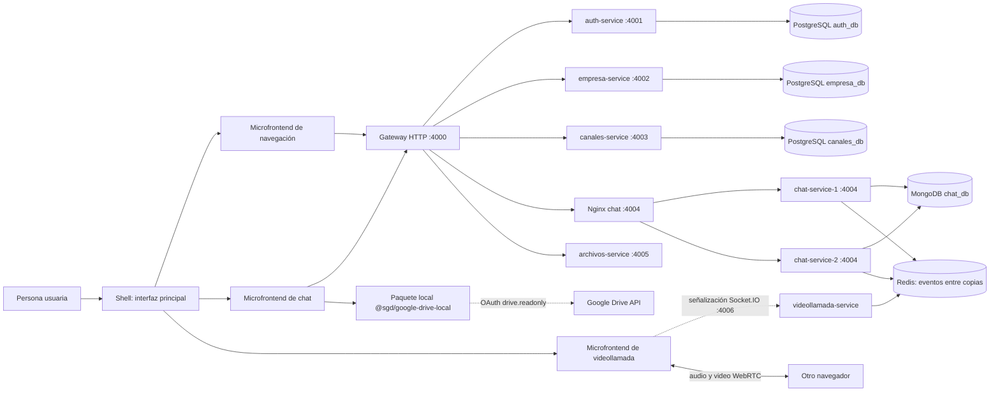

# Arquitectura del sistema de gestión empresarial

## Para qué sirve este documento

Describe la arquitectura que se observa en el repositorio al 24 de noviembre de 2026. Distingue la configuración local, las funciones implementadas y los despliegues que aún están pendientes. Actualiza el estado cuando se publique una nueva versión.

## Resumen sencillo

La aplicación se parece a un espacio de trabajo empresarial: tiene inicio de sesión, empresas, canales, subcanales, hilos y mensajes. La interfaz está dividida en aplicaciones pequeñas llamadas **microfrontends**. El backend está dividido en **microservicios**, cada uno responsable de una parte. El **gateway** es la puerta única por la que la interfaz consulta esos servicios.

Cuando alguien envía un mensaje, el microfrontend de chat hace una petición HTTP al gateway; este la dirige al balanceador Nginx y luego a una de las dos copias del servicio de chat, que guarda el mensaje en MongoDB. Las videollamadas tienen su propio microfrontend y microservicio: Socket.IO coordina su inicio, y WebRTC conecta el audio y video directamente entre navegadores.

## Mapa de componentes

El diagrama representa la composición local descrita por `docker-compose.yml` y el gateway. El puerto 4004 del computador apunta a Nginx, que distribuye HTTP y WebSocket entre las dos copias del chat. Google Drive se conecta desde el navegador mediante el paquete local `local-module`; OAuth concede el permiso `drive.readonly` y el backend solo guarda el enlace y los metadatos seleccionados.

## Responsabilidades

| Parte | Responsabilidad observada |
|---|---|
| `frontends/shell` | Aplicación principal, rutas, sesión y composición de pantallas. |
| `frontends/mf-navegacion` | Componentes para explorar y administrar canales, subcanales e hilos. |
| `frontends/mf-chat` | Interfaz de conversación, mensajes, respuestas, reacciones y adjuntos. |
| `local-module` (`@sgd/google-drive-local`) | Paquete JavaScript local reutilizable que carga Google Identity Services, solicita permiso Drive de solo lectura, lista archivos y adapta enlaces para adjuntarlos al chat. Se importa desde `mf-chat` mediante un alias Vite/TypeScript; no es un servicio desplegable aparte. |
| Google Drive API | El navegador autoriza acceso de solo lectura, lista archivos y adjunta al mensaje su enlace y metadatos. El archivo no se copia al servidor. |
| `frontends/mf-videollamada` | Interfaz independiente de videollamada, integrada en el shell cuando hay un hilo seleccionado. |
| `gateway` | Entrada HTTP en el puerto 4000; enruta `/auth`, `/empresas`, `/canales`, `/subcanales`, `/hilos`, `/mensajes` y `/archivos`. |
| `auth-service` | Operaciones del backend de autenticación. La interfaz también usa Firebase Auth para la sesión. |
| `empresa-service` | Datos y operaciones de empresas. |
| `canales-service` | Canales, subcanales e hilos. |
| `chat-load-balancer` (Nginx) | Distribuye las peticiones HTTP y WebSocket entre las dos copias del servicio de chat. |
| `chat-service` | Consulta, almacenamiento, eliminación y reacciones de mensajes; publica eventos por Socket.IO. |
| `redis` | Comparte eventos de Socket.IO entre las dos copias del servicio de chat. |
| `videollamada-service` | Administra salas de llamada y reenvía la señalización WebRTC por Socket.IO; Redis permite distribuirla entre instancias. |
| `archivos-service` | Recibe adjuntos por el gateway y los guarda en `uploads` local si Cloudinary no está configurado; Cloudinary también se puede configurar en el backend. |

## Persistencia y puertos locales

La configuración actual crea **cuatro bases/instancias de datos**: tres bases PostgreSQL (`auth_db`, `empresa_db`, `canales_db`) y una base MongoDB (`chat_db`). Por lo tanto, “dos bases de datos” no describe la configuración que hoy aparece en `docker-compose.yml`; conviene confirmar con el equipo si se referían a dos tecnologías o a otra versión del proyecto.

| Componente | Puerto expuesto localmente | Persistencia |
|---|---:|---|
| Shell | 5173 | — |
| Microfrontend de navegación | 5174 | — |
| Microfrontend de chat | 5175 | — |
| Microfrontend de videollamada | 5176 | — |
| Gateway | 4000 | — |
| Auth | interno 4001 | PostgreSQL `auth_db` |
| Empresas | interno 4002 | PostgreSQL `empresa_db` |
| Canales | interno 4003 | PostgreSQL `canales_db` |
| Nginx para chat | 4004 | Distribuye al servicio de chat |
| `chat-service-1` y `chat-service-2` | interno 4004 cada uno | MongoDB `chat_db`; Redis para eventos |
| `videollamada-service` | 4006 | Redis para señalización entre instancias |
| Archivos | interno 4005 | Volumen local configurado; proveedor externo opcional |

Los servicios y las bases se definen en `docker-compose.yml`. Para arrancar el proyecto se copia `.env.example` a `.env` y se completan los valores que el equipo tenga configurados. No se deben publicar claves reales ni subir `.env` a GitHub.

### Quién guarda cada dato

| Almacén | Datos que guarda | Servicio que lo usa |
|---|---|---|
| PostgreSQL `auth_db` | Registros relacionados con autenticación del backend. | `auth-service` |
| PostgreSQL `empresa_db` | Empresas y sus datos. | `empresa-service` |
| PostgreSQL `canales_db` | Canales, subcanales e hilos. | `canales-service` |
| MongoDB `chat_db` | Mensajes, respuestas, reacciones y metadatos de adjuntos. | Dos instancias de `chat-service` |
| Redis | Pub/sub del adaptador Socket.IO entre instancias; usado también para coordinar señalización de videollamada. | `chat-service` y `videollamada-service` |

Redis es un almacén adicional de coordinación. Las cuatro bases persistentes que requiere el proyecto son las tres PostgreSQL y MongoDB.

## Módulo local de Google Drive

El módulo está en `local-module/index.js`; `local-module/index.d.ts` describe su API para TypeScript y `local-module/package.json` identifica el paquete local. `mf-chat` consume estas funciones:

| Función | Qué hace |
|---|---|
| `cargarGoogleIdentityServices()` | Carga la biblioteca GIS una sola vez en el navegador. |
| `solicitarTokenDrive(clientId)` | Abre el consentimiento de Google y solicita un token temporal para `drive.readonly`. |
| `listarArchivosDrive(accessToken)` | Consulta Drive API v3 y devuelve hasta 50 archivos recientes. |
| `convertirArchivoDrive(archivo)` | Convierte el resultado en un adjunto compatible con el modelo del chat. |

El archivo no se copia al servidor y el módulo no modifica los permisos de Drive. Para que otra persona abra un enlace, su cuenta debe tener permiso sobre ese archivo. El token de acceso se usa en memoria para la consulta del navegador; no se persiste en MongoDB ni en los mensajes.

### Configuración de Google OAuth

1. Habilitar Google Drive API en el proyecto de Google Cloud.
2. Crear un cliente OAuth de tipo Web y registrar como origen JavaScript cada dominio desde el que se abrirá el shell. En local, el origen normal es `http://localhost:5173`.
3. Definir `VITE_GOOGLE_CLIENT_ID` en `.env` para Docker local o como variable de compilación en el proceso de hosting. Vite compila este valor dentro del frontend.
4. Si el proyecto OAuth está en modo Prueba, añadir cada cuenta que probará Drive en Google Auth Platform → Público → Usuarios de prueba. Las cuentas no incluidas reciben `403 access_denied`.
5. Para usuarios fuera de la lista de prueba, completar los requisitos de publicación/verificación de Google. Cambiar el nombre de marca no publica la app ni agrega usuarios de prueba.

Si el dominio de hosting cambia, también hay que agregar ese origen a OAuth y reconstruir el microfrontend con el mismo Client ID. Nunca guardar secretos OAuth ni tokens en GitHub.

## Construcción del microfrontend de chat

El contexto Docker de `mf-chat` es la raíz del repositorio para que el Dockerfile pueda copiar tanto `frontends/mf-chat` como `local-module`. En desarrollo, `vite.config.ts` expone el alias `@sgd/google-drive-local` y permite que Vite sirva el código local fuera de la carpeta del microfrontend. Si se cambia el nombre o la ubicación del módulo, actualizar ambos puntos de resolución y `docker-compose.yml`.

Para compilar `mf-chat` directamente desde Windows, las dependencias deben estar instaladas; luego se usa `npm run build` desde `frontends/mf-chat`. La compilación genera el remoto `dist/remoteEntry.js` y sus archivos estáticos.

## Recorrido de un mensaje hoy

1. La persona abre un hilo en la aplicación.
2. `mf-chat` solicita el historial por HTTP al gateway. El gateway lo reenvía a Nginx, que selecciona una copia del servicio de chat.
3. `chat-service` consulta o guarda el mensaje en MongoDB.
4. Al guardar, el servicio emite `nuevo-mensaje` a la sala Socket.IO de ese hilo. Para reacciones emite `mensaje-actualizado`.
5. Los navegadores conectados a esa sala reciben el evento sin volver a consultar cada pocos segundos. Al reconectarse, el navegador vuelve a cargar el historial para recuperar lo que pudo perder.

### Adjuntar desde Google Drive

1. En el cuadro de mensaje se elige **Drive** y se autoriza la cuenta Google.
2. `mf-chat` solicita un token temporal para el alcance `drive.readonly` y lista hasta 50 archivos recientes mediante Drive API v3.
3. Al elegir uno, el cliente agrega su nombre, tipo, tamaño y `webViewLink` al mensaje como adjunto. El archivo sigue en el Drive de la persona.
4. Las personas del chat podrán abrirlo si sus cuentas tienen permiso en Drive. El módulo no cambia permisos de archivos ni crea enlaces públicos.

Para habilitar la integración, crear un OAuth Client ID de tipo **Web application** en Google Cloud, habilitar Google Drive API, añadir el origen web usado por la aplicación (por ejemplo `http://localhost:5173`) a los orígenes autorizados y definir `VITE_GOOGLE_CLIENT_ID`. En producción se agrega también el dominio HTTPS. El Client ID no es una contraseña; no se deben guardar tokens en el repositorio.

Eventos de sala que implementa el servidor: `unirse-hilo` y `salir-hilo`, con el identificador UUID del hilo. El cliente escucha `nuevo-mensaje` y `mensaje-actualizado`. El envío y las reacciones siguen usando HTTP; Socket.IO avisa a los demás participantes. En Docker Compose, el cliente se conecta a `http://localhost:4004` (configurable mediante `VITE_SOCKET_URL`), que es el puerto publicado por Nginx. El cliente está configurado para WebSocket, así evita necesitar sesiones persistentes para long-polling.

## Videollamadas implementadas como microfrontend y microservicio

La videollamada está asociada al **hilo seleccionado** dentro de un canal y permite hasta ocho participantes. Quien la inicia elige de una lista a qué personas conectadas al mismo hilo invitar. El microservicio envía la invitación solo a esas cuentas y comprueba la lista permitida antes de admitir a alguien. La pantalla muestra una cuadrícula con el video local y los videos remotos, con controles para silenciar, apagar la cámara y colgar.

**WebRTC** transporta audio y video directamente entre los navegadores. El backend no graba ni retransmite esos medios. El microfrontend independiente `mf-videollamada` se compone desde `shell` junto al chat cuando se selecciona un hilo. Se conecta directamente al microservicio `videollamada-service` en el puerto 4006; los participantes intercambian ofertas, respuestas y candidatos ICE por pares a través de la sala `llamada:<hiloId>`. Esta primera versión usa una conexión WebRTC directa entre cada par de personas (malla), con un máximo de ocho personas por llamada. Redis permite que la señalización funcione entre instancias del microservicio.

La llamada en malla consume más ancho de banda a medida que se suman personas, porque cada navegador envía su audio y video a cada uno de los demás. Para grupos mayores se recomienda pasar a un servidor de medios SFU.

### Eventos de videollamada

| Evento | Dirección | Función |
|---|---|---|
| `llamada:miembros` | Cliente → servidor → cliente | Devuelve las personas conectadas al mismo hilo para que quien inicia seleccione a quién invitar. |
| `llamada:iniciar` | Cliente → servidor | Crea la llamada, guarda quién la inició y la lista permitida; invita solo a las cuentas seleccionadas. |
| `llamada:unirse` | Cliente → servidor | Solicita entrar a la sala del hilo; devuelve un acuse con los participantes presentes o un error. |
| `llamada:entrante` | Servidor → otros clientes del hilo | Muestra los botones Aceptar y Rechazar. |
| `llamada:rechazar` / `llamada:rechazada` | Cliente ↔ servidor | Rechaza la invitación y permite que quien llamó cierre su conexión local. |
| `llamada:senal` | Cliente ↔ servidor ↔ cliente | Intercambia `oferta`, `respuesta` y `candidato` para negociar WebRTC. El servidor solo reenvía la señal a la otra persona de la sala. |
| `llamada:estado-medios` | Cliente ↔ servidor → sala | Avisa si una persona apagó o encendió su cámara o micrófono; el microfrontend muestra los íconos correspondientes. |
| `llamada:participante` | Servidor → sala de llamada | Avisa a quien inició la llamada que otra persona aceptó y permite crear la oferta WebRTC. |
| `llamada:salir`, `llamada:participante-salio`, `llamada:cancelada` | Cliente ↔ servidor | Cierra la llamada, detiene cámara/micrófono y avisa si alguien cuelga o se desconecta. |

### Red y límites de la demo

El cliente usa `VITE_VIDEOLLAMADA_URL` (por defecto `http://localhost:4006`) y un servidor STUN público para descubrir rutas de red. Algunas redes corporativas, VPN o firewalls requieren configurar un servidor TURN; si la llamada no conecta entre redes distintas, TURN es el siguiente componente que debe agregarse. Para probar se necesitan dos usuarios/navegadores en el mismo hilo y conceder permiso de cámara y micrófono. Los navegadores requieren HTTPS en despliegues; `localhost` está permitido para desarrollo.

## Estado del trabajo

| Función | Estado en el repositorio revisado |
|---|---|
| Microservicios y gateway HTTP | Configurados en Compose. |
| Microfrontends | Shell, navegación, chat y videollamada están separados y el shell integra los remotos. |
| Mensajes persistidos | Endpoints REST y almacenamiento MongoDB implementados. |
| Actualización de mensajes en vivo | Socket.IO implementado; sincroniza el historial por HTTP al entrar y reconectar. |
| Videollamadas en canales/hilos | Microfrontend y microservicio propios; videollamada WebRTC en malla de hasta ocho personas en el hilo seleccionado. TURN y SFU quedan fuera del alcance actual. |
| Módulo local de Google Drive | Implementado como paquete `local-module` e integrado en `mf-chat`: OAuth de solo lectura, lista reciente y adjunta enlaces. Requiere configurar el OAuth Client ID, autorizar los dominios y añadir como usuarios de prueba las cuentas que usarán Drive mientras OAuth esté en modo de prueba. |
| Balanceo de cargas del chat | Nginx con dos réplicas de `chat-service` y estrategia `least_conn`; Redis comparte los eventos entre réplicas. |
| Despliegue del backend en AWS | No desplegado. Hay una topología objetivo documentada; faltan cuenta/perfil AWS, imágenes ECR, redes, servicios de datos, secretos, dominio y aprovisionamiento ECS. |
| Hosting de microfrontend | No hay un hosting público activo. Existe una plantilla AWS para S3 privado + CloudFront y un script para `mf-chat`, pero no se ha ejecutado. La captura compartida corresponde a CrazyHost; su plan gratuito indica que Node.js no está incluido y solo podría servir archivos estáticos. |
| Código en GitHub | El código comprometido hasta los PR integrados está en las ramas remotas conocidas localmente. La función del módulo local y los cambios recientes de documentación/despliegue todavía están sin commit en la rama `videollamada`; por eso el árbol de trabajo no está 100% publicado. No se pudo consultar GitHub en línea en la última revisión. |
| Documentación de arquitectura | Actualizada con Drive, balanceador, videollamada y estado de despliegue local/AWS. |

## Despliegue frente a ejecución local

`docker compose up --build` levanta el proyecto en el computador; esto no crea una aplicación pública en la nube. Para que el equipo la use por Internet se necesita, como mínimo:

1. Un host público para el backend Node y sus servicios; las direcciones de API, Socket.IO y videollamada deben ser HTTPS/WSS y accesibles desde los navegadores.
2. Bases persistentes administradas o una infraestructura que las mantenga con respaldo y red privada.
3. Alojar shell y microfrontends estáticos y apuntar sus remotos Federation a las URLs públicas. El shell debe compilar con `VITE_MF_NAVEGACION_URL`, `VITE_MF_CHAT_URL` y `VITE_MF_VIDEOLLAMADA_URL` correctas.
4. Configurar CORS, Firebase Auth, OAuth de Drive, dominios permitidos, HTTPS y servidor TURN si las redes de los usuarios lo requieren.
5. Añadir CI/CD, secretos fuera del repositorio, health checks, logs y una estrategia de respaldo.

El plan gratuito mostrado de CrazyHost excluye Node.js; por sí solo no ejecuta gateway, microservicios, Socket.IO ni el servidor de videollamada. Su hosting estático podría alojar artefactos de frontend si sus límites y forma de publicación son compatibles. Hostinger es otro proveedor; confirmar con el docente cuál cuenta/plan deben utilizar antes de diseñar el despliegue definitivo.

## Cómo probar la videollamada

1. Levanta el proyecto con Docker Compose y espera que `chat-service-1`, `chat-service-2`, Redis, Nginx y los microfrontends estén activos.
2. Abre la aplicación desde dos o más navegadores o sesiones distintas. Todos los usuarios deben entrar en la misma empresa, canal, subcanal e hilo (máximo ocho personas).
3. En el hilo, una persona presiona **Videollamada** y permite el uso de cámara y micrófono.
4. La otra persona acepta la invitación y también concede los permisos.
5. Comprueba el video remoto, los controles de cámara/micrófono y que colgar detiene los dispositivos.

Para trabajar en equipo, cada integrante crea una rama, realiza commits pequeños y abre una solicitud de integración (pull request). Coordina cambios en `services/chat-service/src/socket.ts` con quien mantenga Socket.IO para evitar sobrescribir eventos.

## Archivos de referencia

- `docker-compose.yml`: servicios, puertos, bases y volúmenes.
- `gateway/src/index.ts`: rutas HTTP y destinos de cada servicio.
- `services/chat-service/src/index.ts`: arranque del servicio de chat.
- `services/chat-service/src/routes/mensajes.routes.ts`: rutas HTTP de mensajes.
- `services/chat-service/src/controllers/mensajes.controller.ts`: lógica de lectura y escritura.
- `frontends/mf-chat/src/features/chat/chat.api.ts`: llamadas HTTP e integración cliente de Socket.IO.
- `services/chat-service/src/socket.ts`: salas y eventos de Socket.IO; adaptador Redis opcional.
- `services/chat-load-balancer/nginx.conf`: distribución de tráfico HTTP/WebSocket.
- `frontends/mf-chat/src/features/chat/components/ChatArea.tsx`: pantalla de conversación y ubicación del control de llamada.
- `frontends/mf-videollamada/src/components/VideoLlamada.tsx`: captura de cámara/micrófono, conexión WebRTC y controles de llamada.
- `services/videollamada-service/src/socket.ts`: salas y señalización Socket.IO del microservicio de videollamada.
- `frontends/shell/src/App.tsx`: rutas de la aplicación principal.
